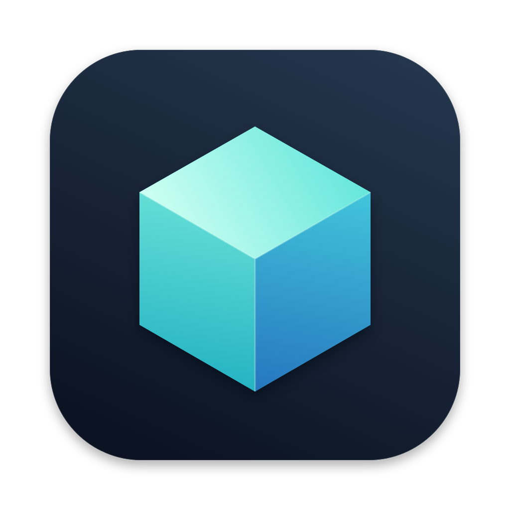
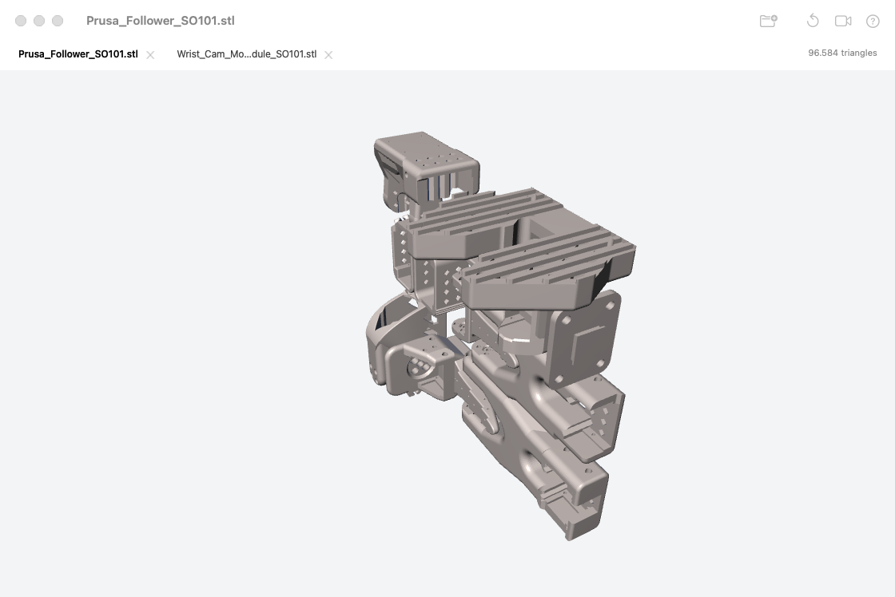
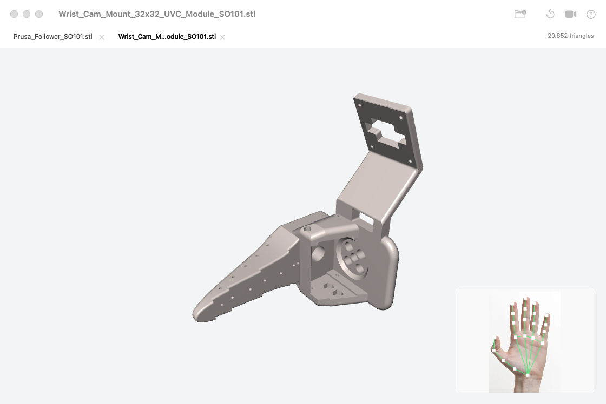

# Polyscope



A small 3D model viewer for macOS, written in C++ and OpenGL. Open models in tabs,
inspect them with a mouse or trackpad, or turn on hand controls through Apple Vision.
The interface follows the system's light or dark appearance.

Supports **3MF, STL, OBJ, PLY, glTF/GLB, FBX, and Collada**. Geometry and normals
are imported; materials, textures, and animations aren't rendered yet.

## Demos

SO101 parts open in separate tabs, ready to inspect with a mouse or trackpad.



Hand controls add a small preview with tracked hand landmarks. This demo uses a
[sample hand photo](assets/demos/README.md); no webcam capture is included.



## Build and install

Requires macOS 11+, CMake 3.24+, and Xcode or its Command Line Tools. If needed,
install the tools with `xcode-select --install`, then run from the project folder:

```bash
make setup    # check tools; install CMake through Homebrew if needed
make install  # build and install /Applications/Polyscope.app
```

Without Homebrew, install [CMake](https://cmake.org/download/) and add it to your
`PATH`. GLFW, GLM, and Assimp download on the first build. The app includes its
resources and dependencies, so it runs without the source folder.

Launch **Polyscope** from Applications or Spotlight. To install in your own
Applications folder instead:

```bash
make install APPLICATIONS_DIR="$HOME/Applications"
```

Quit the app before installing or updating. To pull the latest changes, rebuild,
and replace the installed app:

```bash
make update
```

Updates use `git pull --ff-only` and require a clean checkout with an upstream
branch. Use `make install` to install local edits without pulling. For a per-user
installation, pass the same `APPLICATIONS_DIR` option when updating.

## Using Polyscope

The viewer starts with a cube. Drop one or more models onto the window, or choose
**Open** (`⌘O`). Each file opens in a closable tab and replaces the starter cube.
Drop more files at any time; reopening a file selects its existing tab. Each tab
keeps its own view position. Closing the last tab brings back the cube.

Models load in the background. Files that can't be opened leave existing tabs
intact. You can also use Finder's **Open With** or drop files onto the app icon.

The toolbar has Open, Reset View, Hand Controls, and Help. Grid and wireframe
options are in **View**; preview preferences are in **Polyscope → Settings…**.

## Controls

| Input | Action |
| --- | --- |
| Drag | Orbit |
| Right-drag or `⇧`-drag | Pan |
| Scroll or trackpad pinch | Zoom |
| `⌘O` / `⌘W` | Open models / close the current tab |
| `⌃Tab` / `⌃⇧Tab` | Next / previous tab |
| `⌘0` or `R` | Reset view |
| `G` / `W` | Toggle grid / wireframe |
| `C` | Toggle hand controls |
| `⌘,` / `⌘?` | Settings / Help |
| `⌘Q` | Quit |

On the starter screen, `⌘W` closes the window.

## Hand controls

The camera is **off at every launch**. Click the camera button or press `C` to
enable hand controls. macOS asks for permission when needed; if access is blocked,
allow Polyscope in the system's camera privacy settings.

| Gesture | Action |
| --- | --- |
| Open palm, then move | Orbit |
| Peace sign, then move | Pan |
| Pinch, then move closer or farther | Zoom in or out |
| Fist or one raised finger | Pause and reposition |

Keep your palm facing the camera and hold a pose briefly before moving. To
reposition your hand, pause, move back to a comfortable spot, then resume.
Settings lets you change preview mirroring or hide the preview while keeping
hand controls active. Turning hand controls off stops camera capture.

## Development

```bash
make build    # build/Polyscope.app
make run      # build and launch
make test     # model, tab, gesture, camera-frame, and bundle tests
make icon     # rebuild the icon from scripts/generate-icon.swift
```

Additional checks use the built executable:

```bash
build/Polyscope.app/Contents/MacOS/Polyscope --smoke-test
build/Polyscope.app/Contents/MacOS/Polyscope --ui-smoke-test
build/Polyscope.app/Contents/MacOS/Polyscope --camera-smoke-test
```

These check rendering, the native interface and file-loading workflow, and live
camera capture respectively. The camera check stops after one frame and skips
capture if permission hasn't already been granted.

Builds target the current Mac's architecture and use an ad hoc code signature.
Developer ID signing and notarization aren't configured.
